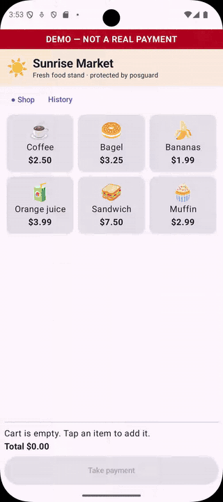
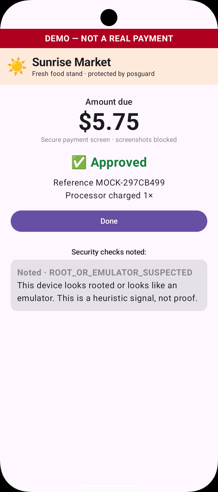
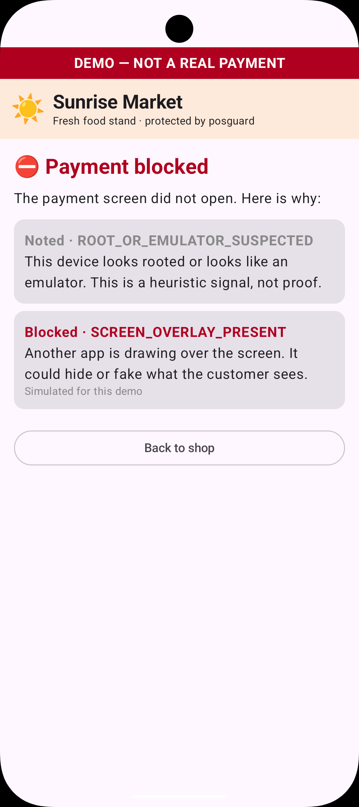
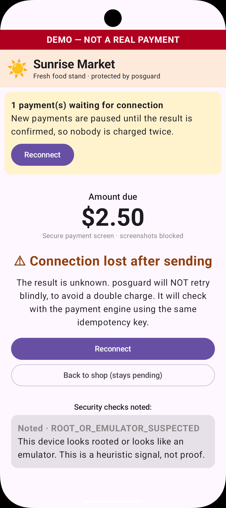

# posguard

> Working codename. Product name TBD. **Early development: not ready for production use.**

posguard is an open-source Android toolkit that helps payment-app makers keep card payments on Android phones and POS devices **secure and reliable**. It targets three situations: the phone may be compromised, the network or app may fail mid-payment, or the store has to adopt new requirements such as chip and tap EBT cards.

**posguard wraps the certified payment engine. It never replaces it.** Card reading, EMV processing, PIN handling, and card-data encryption stay inside certified payment SDKs and hardware. posguard protects the merchant app around them:

- **Phone-terminal integrity:** device, app, and screen checks (overlays, screen capture, risky accessibility services, root, emulator, debugger) before payment acceptance opens.
- **EBT readiness (simulator):** chip-first EBT checkout with safe fallback, SNAP-eligible basket split from config, split tender, partial approvals, and receipt fields, for USDA's proposed chip-and-tap EBT requirement. PINs and card reading stay inside the certified engine.
- **Relay-risk flags (experimental):** rules on engine-reported tap metadata, such as a burst of phone-wallet taps, that hold an approved payment for the merchant's review. Never a decline.
- **Outage-safe transaction journal:** a payment is never lost and never charged twice, even if the app crashes or the network drops mid-payment.
- **Secure telemetry:** error and event reporting that strips card-like data before it leaves the device, with pluggable sinks including a signed HTTPS webhook.
- **Mock payment engine and demo app:** "Sunrise Market", a fictional small grocer, that runs fully offline.

## Why it matters

- Cards make up over three quarters of 236.6 billion U.S. noncash payments (Federal Reserve Payments Study, 2025 initial findings).
- 29.8 million of 36.2 million U.S. small businesses have no employees (SBA Office of Advocacy, 2026), and phones are becoming their payment terminal (Visa reports 20M+ Tap to Phone devices, company data).
- The U.S. Secret Service reports POS and ATM skimming losses of over $1 billion a year, and increasingly targets EBT skimming.
- USDA proposed (October 2026) that SNAP retailers accept chip and contactless EBT, with magnetic-stripe fallback only after a failed chip attempt (91 FR 66958; comments due December 22, 2026). USDA reports at least $360 million in stolen SNAP benefits replaced through mid-fiscal-year 2025.
- PCI validates the payment kernel. The merchant app around it is not covered by that certification. That app is what posguard protects.

## Demo: Sunrise Market

A fictional food stand that runs fully offline, using a mock payment engine and a mock integrity server. Every screen says **DEMO — NOT A REAL PAYMENT**. Long-press the ☀ logo for Demo controls. See the [2-minute demo script](docs/demo-script.md).



*Scenarios 1–5 and scrubbed telemetry, driven automatically on an API 36 emulator (5× speed).*

| 1 · Normal payment | 2 · Overlay blocked | 4 · Network drop: no blind retry | 5 · Recovered after a crash |
|---|---|---|---|
|  |  |  |  |

## What posguard does not do

- No EMV kernels, card reading, PIN entry, or card-data encryption.
- No payment processing and no real card or EBT processor integrations.
- No PCI certification and no claim of PCI compliance.
- No physical skimmer detection. No iOS.

## Status

Milestone 1: the libraries and the demo are done, and demo scenarios 1–5 have been verified on an Android 16 (API 36) emulator. First release: [v0.1.0](docs/releases/v0.1.0.md). Milestone 2 added experimental relay-risk flags and a signed webhook sink. **Milestone 3, EBT readiness (in progress):** `posguard-ebt` and `ebt-simulator` are built and tested, and demo scenario 9 runs an EBT purchase with SNAP split, chip-to-tap fallback, and a partial approval. Emulator run pending. See [CHANGELOG.md](CHANGELOG.md).

Docs: [architecture](docs/architecture.md) · [threat model](docs/threat-model.md) · [integrity signals](docs/integrity.md) · [ledger](docs/ledger.md) · [event schema](docs/event-schema.md) · [policy defaults](docs/policy-defaults.md) · [relay-risk flags](docs/relay-risk.md) · [EBT readiness](docs/ebt.md) · [decisions](docs/decisions/)

## Quick start (under 5 minutes)

Requirements: JDK 17 or newer, the Android SDK, and a device or emulator (Android 8.0+).

```sh
echo "sdk.dir=/path/to/Android/Sdk" > local.properties
./gradlew :demo-app:installDebug   # installs Sunrise Market
./gradlew build                    # all modules: compile, lint, unit tests
```

Using the libraries in your app:

```kotlin
val engine = /* your adapter around the certified SDK; implements EngineStatusSource */
val ledger = PosGuardLedger.Builder(context, engine).build()
val integrity = PosGuardIntegrity.install(application)
val guard = PosGuard.Builder(ledger).signals(integrity.signals()).build()

ledger.recoverPending()                       // on start: resolve unfinished payments first
when (val verdict = guard.preflight()) {      // before opening payment acceptance
    is GuardVerdict.Block -> showWhyBlocked(verdict.reasons)
    else -> openPaymentScreen()
}
```

See [CONTRIBUTING.md](CONTRIBUTING.md) for project rules.

## License

[Apache License 2.0](LICENSE)
